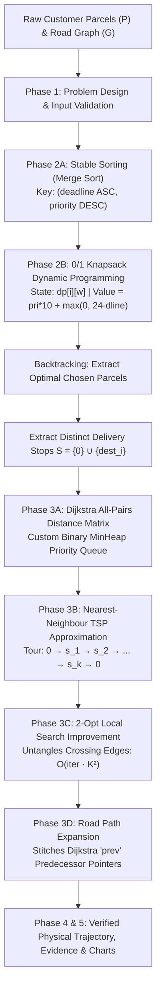

# Mini-Courier Planner: System Architecture & Algorithmic Design

**Course:** Design & Analysis of Algorithms (ETCCDA302)  
**Institution:** K.R. Mangalam University, Gurugram, Haryana  
**Assessment:** Capstone Project (100 Marks scaled down to 10 Marks)  
**Faculty Evaluator:** Dr. Shweta Agarwal  
**Implementation:** Pure Python (Zero external library shortcuts for core algorithms)

---

## 1. Executive Summary & Problem Formulation

In modern urban logistics, last-mile delivery services face an NP-hard operational optimization challenge: dispatching delivery vans from a central depot with more customer orders than payload capacity permits, while meeting tight deadlines, satisfying priority levels, and minimizing driving distances over non-Euclidean road networks.

The **Mini-Courier Planner** solves this by formulating the logistics pipeline into four distinct, mathematically rigorous algorithmic phases:
1. **Prioritization:** Stable order ranking based on delivery urgency and service level.
2. **Payload Optimization:** Constrained subset selection maximizing delivered value within integer payload limits ($0/1$ Knapsack).
3. **Road Routing & Shortest Paths:** Point-to-point shortest road routing over an undirected weighted network (Dijkstra on an Adjacency-List Graph).
4. **Tour Scheduling & Trajectory Expansion:** Route scheduling visiting all selected customer stops and returning to the depot (Metric TSP via Nearest-Neighbour and $2$-Opt Local Search), followed by full physical junction trajectory expansion.

---

## 2. End-to-End System Architecture

The following flowchart outlines how data flows seamlessly between the core algorithmic stages:

---

## 3. Data Design & Formal Models

### 3.1 Parcel Representation (`courier/models.py`)
Each customer parcel $p \in P$ is modeled with five core attributes:
- $\text{pid} \in \Sigma^+$: Unique parcel tracking identifier (e.g., `P0001`).
- $\text{dest} \in \{1, 2, \dots, |V|-1\}$: Destination junction node in the road network (node $0$ is reserved for the depot).
- $\text{weight} \in \mathbb{Z}^+$: Parcel weight in integer kilograms ($1 \le w_i \le W$).
- $\text{priority} \in \{1, 2, 3, 4, 5\}$: Customer urgency tier ($5$ is highest).
- $\text{deadline} \in \mathbb{Z}^+$: Promised delivery window in hours from dispatch ($2 \le d_i \le 48$).

#### Knapsack Value Formulation
To align economic utility with customer satisfaction, parcel value $v_i$ is computed dynamically:
$$v_i = (\text{priority}_i \times 10) + \max(0, 24 - \text{deadline}_i)$$

*Rationale:* Base priority scales value into bands $[10, 50]$. Parcels promised within same-day turnaround ($\le 24$ hours) receive an urgency bonus up to $+22$ points, prioritizing critical medical or express deliveries.

### 3.2 Road Graph Representation (`courier/graph.py`)
The road network is an undirected weighted graph $G = (V, E, w)$, where:
- $V = \{0, 1, \dots, |V|-1\}$ represents road intersections and delivery points.
- Node $0$ is the central logistics depot.
- $E \subseteq V \times V$ represents bidirectional road segments.
- $w: E \to \mathbb{R}^+$ assigns non-negative road distances (km) or transit times.
- Stored as an **Adjacency List** mapping $u \mapsto \{(v, w(u,v)), \dots\}$.
- Each vertex also carries 2D spatial coordinates $(x_u, y_u) \in \mathbb{R}^2$ for spatial consistency and visualization.

---

## 4. Phase-by-Phase Algorithmic Breakdown

### Phase 1: Courier Problem Design and Input Validation
- Validates graph connectivity: Ensures a single connected component using an initial Minimum Spanning Tree (MST) structure so that all delivery destinations are reachable from Depot $0$.
- Verifies non-negativity of weights ($w(e) > 0$) as required by Dijkstra's algorithm.

### Phase 2: Package Prioritization and Box Filling

#### Step 1: Merge Sort (`courier/sorting.py`)
- **Key Extraction:** Tuple $(\text{deadline}_i, -\text{priority}_i)$.
- **Stability Guarantee:** By strictly using $\le$ when merging sub-arrays (`left[i] <= right[j]`), Merge Sort preserves the original FIFO registration order among parcels with identical deadlines and priorities.
- **Complexity:**
  - Time: $\Theta(n \log n)$ (Best, Average, and Worst cases).
  - Space: $\Theta(n)$ auxiliary memory for merging buffers.
- **Baselines Implemented:**
  - *Randomized 3-Way Quick Sort:* Uses Dutch National Flag partitioning (`< pivot`, `== pivot`, `> pivot`) to handle duplicate deadline/priority keys in $O(n)$ time. Average time $O(n \log n)$, worst case $O(n^2)$.
  - *Bubble Sort:* $O(n^2)$ exchange sort with early-termination flag, serving as the quadratic baseline for performance benchmarking.

#### Step 2: 0/1 Knapsack Dynamic Programming (`courier/knapsack.py`)
- **Capacity Constraint:** Courier van payload capacity $W \in \mathbb{Z}^+$.
- **Subproblem Definition:** $dp[i][w]$ represents the maximum total priority value achievable choosing from the first $i$ sorted parcels with total weight at most $w$ kg.
- **Bellman Optimality Recurrence:**
  $$dp[i][w] = \begin{cases} 
  0 & \text{if } i = 0 \text{ or } w = 0 \\
  dp[i-1][w] & \text{if } w_i > w \\
  \max\left(dp[i-1][w], \, dp[i-1][w - w_i] + v_i\right) & \text{if } w_i \le w 
  \end{cases}$$
- **Backtracking Reconstruction:** Starting at cell $(n, W)$, if $dp[i][w] \ne dp[i-1][w]$, parcel $i-1$ is added to the manifest, and the search proceeds to $(i-1, w - w_i)$. Otherwise, it proceeds to $(i-1, w)$.
- **Complexity:**
  - Time: $\Theta(n \cdot W)$ pseudo-polynomial time.
  - Space: $\Theta(n \cdot W)$ storing the full DP matrix.

### Phase 3: Route Maker & Graph Processing

#### Step 1: Hand-Crafted Binary Min-Heap & Dijkstra (`courier/graph.py`)
- Standard library heapq is bypassed in favor of a custom `MinHeap` class implementing:
  - `insert(key, value)` with `_sift_up` in $O(\log |V|)$.
  - `extract_min()` with `_sift_down` in $O(\log |V|)$.
- **Dijkstra Invariant:** At each step, the vertex $u$ with the minimum tentative distance $d[u]$ in the MinHeap is finalized. Because all edge weights $w \ge 0$, no subsequent relaxation can produce a shorter path to $u$.
- **All-Pairs Metric Distance Matrix:**
  Let $S = \{0\} \cup \{\text{dest}(p) \mid p \in \text{chosen\_parcels}\}$. Dijkstra is run $|S|$ times.
  $$\text{dist\_matrix}[(u, v)] = \text{shortest road distance between } u, v \in S$$
  Predecessor maps $\text{prev}_u$ are retained for each $u \in S$.
- **Complexity:**
  - Time: $O(|S| \cdot (|E| + |V| \log |V|))$.

#### Step 2: Nearest-Neighbour (NN) TSP Approximation (`courier/tsp.py`)
- **Greedy Strategy:**
  1. Initialize tour $T = [0]$, visited set $V_S = \{0\}$.
  2. Let current node be $c = 0$.
  3. While $|V_S| < |S|$:
     - Select unvisited stop $v^* = \arg\min_{v \in S \setminus V_S} \text{dist\_matrix}[(c, v)]$.
     - Append $v^*$ to $T$, mark visited, set $c \leftarrow v^*$.
  4. Append $0$ to close the tour.
- **Metric Property:** Because distances are derived from shortest paths in $G$, the triangle inequality holds:
  $$\text{dist\_matrix}[(u, w)] \le \text{dist\_matrix}[(u, v)] + \text{dist\_matrix}[(v, w)] \quad \forall u, v, w \in S$$
- **Complexity:** Time $\Theta(|S|^2)$, Space $O(|S|)$.

#### Step 3: 2-Opt Local Search Improvement (`courier/tsp.py`)
- Eliminates sub-optimal crossings and twists in the NN tour.
- Iteratively considers edge pairs $(t_{i-1}, t_i)$ and $(t_j, t_{j+1})$ and evaluates:
  $$\Delta = \left(d(t_{i-1}, t_j) + d(t_i, t_{j+1})\right) - \left(d(t_{i-1}, t_i) + d(t_j, t_{j+1})\right)$$
- If $\Delta < 0$, the subsegment $T[i:j+1]$ is reversed. Guaranteed never to worsen the tour length.

#### Step 4: Road Path Expansion (`courier/tsp.py`)
- High-level tour $[0, s_1, s_2, \dots, 0]$ is converted into concrete street navigation.
- For each leg $(u \to v)$, Dijkstra's `prev_u` pointers are traced using `reconstruct_path(prev_u, u, v)`.
- Reconstructed paths are chained without repeating boundary junctions:
  $$[0, j_1, \dots, s_1, j_2, \dots, s_2, \dots, 0]$$
- Sum of physical edge weights along this expanded route exactly matches the TSP tour length.

---

## 5. Comprehensive Algorithmic Complexity Table

| Algorithm | Component | Time Complexity (Best) | Time Complexity (Avg) | Time Complexity (Worst) | Space Complexity | Optimality Guarantee |
|:---|:---|:---:|:---:|:---:|:---:|:---|
| **Merge Sort** | Parcel Sorting | $\Omega(n \log n)$ | $\Theta(n \log n)$ | $O(n \log n)$ | $O(n)$ | Optimal & Stable |
| **Quick Sort (3-way)** | Baseline Sorter | $\Omega(n)$ (equal keys) | $\Theta(n \log n)$ | $O(n^2)$ | $O(\log n)$ | Optimal (Unstable) |
| **Bubble Sort** | Baseline Sorter | $\Omega(n)$ | $\Theta(n^2)$ | $O(n^2)$ | $O(1)$ | Optimal & Stable |
| **0/1 Knapsack DP** | Parcel Selection | $\Theta(n \cdot W)$ | $\Theta(n \cdot W)$ | $\Theta(n \cdot W)$ | $\Theta(n \cdot W)$ | Globally Optimal |
| **Knapsack Brute-Force** | Test Verifier | $\Theta(2^n \cdot n)$ | $\Theta(2^n \cdot n)$ | $\Theta(2^n \cdot n)$ | $O(n)$ | Globally Optimal |
| **Binary MinHeap** | Priority Queue | $O(1)$ peek | $O(\log V)$ | $O(\log V)$ | $O(V)$ | Strict Min-Heap Invariant |
| **Dijkstra's Algorithm** | Shortest Paths | $O((V+E)\log V)$ | $O((V+E)\log V)$ | $O((V+E)\log V)$ | $O(V)$ | Globally Optimal |
| **Bellman-Ford** | Test Verifier | $O(V \cdot E)$ | $O(V \cdot E)$ | $O(V \cdot E)$ | $O(V)$ | Globally Optimal |
| **Nearest-Neighbour TSP** | Tour Planning | $\Theta(K^2)$ | $\Theta(K^2)$ | $\Theta(K^2)$ | $O(K)$ | Metric Approximation ($\le \frac{1}{2}\lceil\log_2 K\rceil$) |
| **2-Opt Local Search** | Tour Refinement | $O(K^2)$ | $O(\text{iter} \cdot K^2)$ | $O(\text{iter} \cdot K^2)$ | $O(K)$ | 2-Optimal Local Optimum |
| **Exact TSP (Permutations)**| Test Verifier | $\Theta((K-1)! \cdot K)$ | $\Theta((K-1)! \cdot K)$ | $\Theta((K-1)! \cdot K)$| $O(K)$ | Globally Optimal |
| **Road Path Expansion** | Junction Stitches| $O(H)$ | $O(H)$ | $O(H)$ | $O(H)$ | Exact Shortest Physical Path |

*(Where $n$ = parcels, $W$ = van capacity, $V$ = graph vertices, $E$ = road segments, $K$ = delivery stops, $H$ = total road junction hops).*

---

## 6. Verification and Correctness Rationale

To ensure absolute rigor, every algorithm is paired with an independent mathematical validator in `test_courier.py`:
1. **Sorts vs Python `sorted()`:** Merge Sort, 3-way Quick Sort, and Bubble Sort outputs are compared against Python's Timsort on identical random inputs. Merge Sort stability is tested using duplicate keys with unique tags.
2. **0/1 Knapsack DP vs Exhaustive Bitmask Search ($O(2^n)$):** DP values are proven identical to brute force over randomly generated parcel instances.
3. **Dijkstra vs Bellman-Ford ($O(V \cdot E)$):** On multiple connected graphs with positive weights, Dijkstra distances are verified against Bellman-Ford down to $10^{-6}$ precision.
4. **Nearest-Neighbour vs Exact Permutation TSP ($O(K!)$):** Heuristic tour length is verified to satisfy $\text{length}(NN) \ge \text{length}(OPT)$ and $\text{length}(2\text{-Opt}) \le \text{length}(NN)$.
5. **Physical Path Continuity:** Every consecutive pair in the expanded road sequence is verified to exist as an actual edge in the graph's adjacency list.

